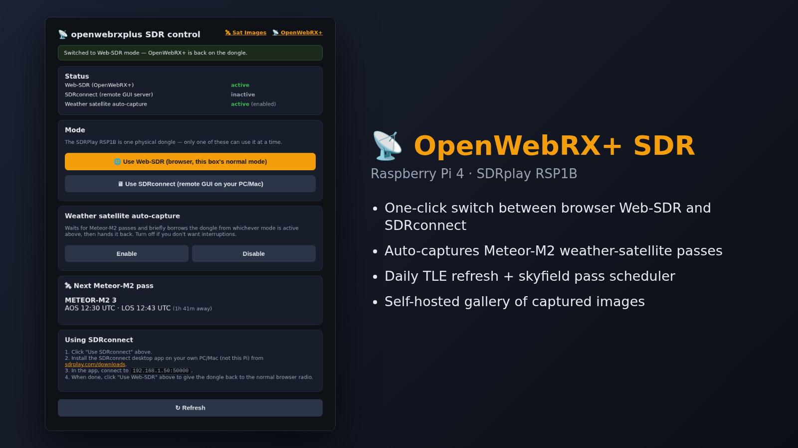

# openwebrxplus-sdr



Scripts and systemd units for `openwebrxplus` — a Pi 4B running OpenWebRX+
natively (systemd, not Docker) with an SDRPlay RSP1B. This is a companion setup to
[prepperpi](https://github.com/tomaszdd/prepperpi), which has its own separate RTL-SDR-based
version of the same weather satellite pipeline.

## What's here

- **`owrx-panel.py`** — web control panel (`:8092`) to switch the single RSP1B dongle between
  Web-SDR (OpenWebRX+), SDRconnect (remote GUI server), and the weather satellite scheduler,
  since only one can hold the device at a time. Handles the stop/settle-delay/start sequencing
  automatically (OpenWebRX+ takes a few seconds to actually release the SDR after being stopped).
- **`owrx-tle-update`** — daily-refreshed cache of the 4 active Meteor-M2 satellites' TLEs from
  Celestrak.
- **`owrx-satsched`** — waits for the next >=20° elevation Meteor-M2 pass (skyfield + IP
  geolocation), stops OpenWebRX+, runs `satdump live meteor_m2-x_lrpt --source sdrplay`, restarts
  OpenWebRX+, files resulting images + a `manifest.json`.
- **`owrx-satimages.html`** — gallery page for captured images, served standalone on `:8091`
  (deliberately not routed through the existing nginx+Varnish reverse proxy, to avoid any risk to
  the working Web-SDR setup).
- **`systemd/`** — unit files for all of the above, plus a copy of `sdrconnectserver.service`
  (created by SDRplay's own official installer, included here for reference/documentation only —
  don't hand-install it, see below).

## SDRconnect (remote GUI) setup

SDRuno is Windows-only with no remote-device support. SDRconnect is SDRplay's newer app —
cross-platform (Windows/Mac/Linux/Pi) with an actual client/server split for this exact use case.

**Important**: install via SDRplay's own official script, not by hand-extracting the tarball —
the tarball's `SDRconnect_headless` binary looked plausible (has a `--websocket_port` flag,
starts fine) but is NOT the real remote-server component and doesn't speak the same protocol as
the desktop client. It causes a silent "protocol error" with no diagnosable network-level cause;
we lost a fair amount of time confirming this. The one that actually works is the official
installer's `SDRconnect --server` mode:

```bash
ACCEPTLICENSE=1 SYSTEMD_MODE=install SYSTEMD_TARGET=sdrconnectserver \
  bash -c "$(curl -fsSL https://www.sdrplay.com/software/install.sh)"
```

This installs to `/opt/sdrconnect` + `/opt/rigcontrol`, sets proper udev rules for the RSP
hardware, and creates `sdrconnectserver.service` (`ExecStart=/opt/sdrconnect/SDRconnect --server`).
**It listens on port 50000**, not the port the CLI examples might suggest.

Desktop client: install the matching SDRconnect version from
[sdrplay.com/downloads](https://www.sdrplay.com/downloads/) (mismatched versions between server
and client also produce the same protocol error), add a Remote Device with:
- IP: set `OWRX_HOST_IP` (defaults to `192.168.1.50`)
- Port: `50000`
- Leave the `nRSP-ST` toggle **off** — that's for an actual nRSP-ST hardware appliance, not this
  headless-server setup, and turning it on causes the same protocol error.
- User/Password fields can be left blank — this server has no auth layer configured.

## Config (not committed)

`owrx-panel.py` reads Basic Auth credentials from `/etc/openwebrxplus/panel.conf` (not tracked in
git — create your own):

```bash
sudo mkdir -p /etc/openwebrxplus
sudo tee /etc/openwebrxplus/panel.conf <<'EOF'
PANEL_USER=admin
PANEL_PASS=your-own-password-here
EOF
sudo chmod 600 /etc/openwebrxplus/panel.conf
```

## Known gotcha: dongle re-enumeration after disconnect

If the RSP1B is physically unplugged/replugged, the shared `sdrplay.service` API daemon can end
up in a stale state even though `systemctl status` reports it healthy — showed up as unusually
high accumulated CPU time. Fix: `sudo systemctl restart sdrplay` after any physical reconnection,
before troubleshooting anything else.

## Deploy

```bash
sudo cp owrx-panel.py owrx-tle-update owrx-satsched /usr/local/bin/
sudo chmod +x /usr/local/bin/owrx-panel.py /usr/local/bin/owrx-tle-update /usr/local/bin/owrx-satsched
sudo mkdir -p /var/www/satimages
sudo cp owrx-satimages.html /var/www/satimages/index.html
sudo cp systemd/owrx-panel.service systemd/owrx-satsched.service systemd/owrx-satgallery.service \
        systemd/owrx-tle.service systemd/owrx-tle.timer /etc/systemd/system/
sudo systemctl daemon-reload
sudo systemctl enable --now owrx-panel owrx-satgallery owrx-tle.timer
# owrx-satsched is NOT auto-enabled here — it competes with Web-SDR/SDRconnect for the one
# dongle, so turn it on deliberately via the control panel (:8092) once you want it running.
```
